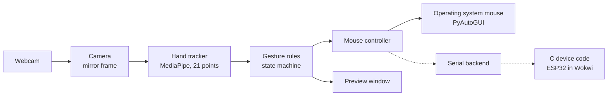

<div align="center">

# AI Gesture Control

**Control your mouse with one hand in front of your laptop's webcam. Everything runs on your own computer.**

[](https://github.com/khoahonguyen0210/AI_Gesture_Control/actions/workflows/ci.yml)


[](LICENSE)

</div>

| Gesture | On your computer | In the Wokwi simulator (`--serial`) |
|---|---|---|
| Point with your index finger | Move the cursor | The dot moves on the OLED screen |
| Pinch thumb and index briefly | Left click | The green LED flashes |
| Hold the pinch and move | Drag | The green LED stays on and the filled dot moves |
| Pinch thumb and middle finger | Right click | The blue LED flashes |
| Raise index and middle, move hand | Scroll | The `S` number goes up or down |
| Press `p` | Pause or resume | The screen shows `PAUSED` and any held button is released |
| Press `q` or Esc | Quit | All buttons are released; after 5 seconds the board plays its demo |

## Results

Measured on one laptop (ThinkPad X1 Yoga, Intel i7-1260P, Windows 11, plugged in), at 640x480, in evening room light, with no hand in view. Each run is 2000 frames. The times cover the software pipeline from reading a frame to sending the mouse event. They do not include camera exposure or screen delay.

| Measure | Before profiling | After profiling |
|---|---|---|
| Frames per second | 9.8 | **16.4 to 19.5** |
| Median time per frame | 100.3 ms | **56.2 to 58.2 ms** |
| Camera start time, Media Foundation driver | 7.0 to 14.8 s | **3.0 to 4.0 s** |

| Other measures | Result |
|---|---|
| Automated tests | **176 passed**, no camera or mouse needed |
| Line coverage | **92%** overall; gesture logic **99 to 100%** |
| C protocol tests | **1,000,068 checks** passed, with memory and undefined-behavior checkers |
| C and C++ parsers compared | **202,004** test streams and **533,065** fuzzed inputs, **0** differences |
| Failed camera reads in the benchmark runs | **0** of 6000 frames |
| ESP32 firmware for Wokwi | Builds with **0** warnings; uses **6.8%** of RAM and **23.1%** of flash |

Profiling found that one Windows camera driver (DirectShow) gave only 9.9 frames per second, while another (Media Foundation) gave 30. Switching drivers made the largest difference. The hand model now takes most of each frame, so rewriting code in C++ or Rust would not help, and it was not done.

Not measured yet: gesture recognition accuracy on a real hand and a benchmark with a hand in view. The tools for both are ready (see [Testing](#testing)). Every measurement and its conditions are in [`research/handover/test_log.md`](research/handover/test_log.md).

## How it works



MediaPipe's pretrained hand model finds 21 points on the hand. The gestures themselves are found with simple geometry rules, not a trained model: a finger counts as straight when its tip is farther from the wrist than its middle joint, and a pinch is the fingertip gap divided by the hand's size, so distance from the camera does not matter.

## Gestures and safety

- **Clicks happen once.** A pinch must last 3 frames before it counts, and must open past a wider gap before it ends, so a shaky pinch cannot click twice.
- **Clicks land where you pointed.** The cursor stops moving when a pinch starts, so closing your fingers does not move it away.
- **A short pinch clicks, a long pinch drags.** A pinch held for 350 ms becomes a drag.
- **No hand, no action.** If the hand leaves the view during a drag, the button is released after 5 frames. A second check in the main loop also releases any held button.
- **You can always stop it.** Press `p` to pause and `q` or Esc to quit. Moving the real cursor into a screen corner stops the app, and Ctrl+C in the terminal works too.
- **Every exit releases the mouse.** Buttons, camera, model, and window are released in a fixed order, even after an error.

All numbers are starting values and can be changed in [`config/default.toml`](config/default.toml).

## Serial protocol in C and C++

An optional part of the project sends the same mouse actions to an external device over a serial link. The device side is plain C written so it could run on a microcontroller. It checks every frame with a CRC, recovers after garbage bytes, rejects anything it does not know, and releases all buttons if the laptop goes silent.

A second parser, written separately in modern C++ from the protocol rules, checks the C parser. Both read the same byte streams, and any difference in the frames they accept or the errors they report counts as a bug. The C++ side also computes the CRC a different way (with a lookup table), so the CRC is checked too. A seeded test runs over 200,000 damaged streams in CI, and libFuzzer searches for new inputs on its own. When a bug was planted in the C parser on purpose, the test found 26,448 mismatching streams.

The C tests run on the laptop. The same C files also run on a simulated ESP32 in Wokwi (see below). No real board was used.

```bash
python firmware/build.py --test --sanitize
python firmware/build.py --fuzz 120
```

### Wokwi simulator

[`firmware/wokwi/`](firmware/wokwi/) runs the device code on a simulated ESP32 with a small OLED screen and three LEDs. A simulated board cannot act as a USB mouse for Windows, so it shows each action instead. The [table at the top](#ai-gesture-control) lists what each gesture does on the board. The parts of the board are:

| Part | Meaning |
|---|---|
| Top line | The mode (`LIVE`, `DEMO`, or `WAIT`) and the gesture name, such as `POINT`, `DRAG`, or `NO HAND` |
| Second line | `ok` good frames, `bad` rejected frames, `wd` buttons released by the watchdog |
| Box with a dot | The computer screen. The dot is the cursor; it is filled while the left button is down |
| `L` and `R` boxes | The left and right buttons; filled while pressed |
| `S` number | The total scroll |
| Green, blue, and yellow LEDs | Left button, right button, and frames arriving |

If no app is connected for 5 seconds, the board plays a built-in demo. The demo also sends garbage bytes, a frame with a broken CRC, and a held button followed by silence, so you can see the device reject bad input and release the button on its own.

To connect the gesture app, you need [Wokwi for VS Code](https://docs.wokwi.com/vscode/getting-started) with its free license for open-source projects, and PlatformIO to build the firmware:

```powershell
python -m pip install platformio
pio run -d firmware/wokwi
python -m pip install -e ".[serial]"
```

Then in VS Code, press F1, choose "Wokwi: Select Config File" and pick `firmware/wokwi/wokwi.toml`, and start the simulator. Keep its tab visible, or the simulation pauses. Then run:

```powershell
python -m gesture_mouse --serial rfc2217://localhost:4000
```

The app sends HELLO first and stops with a clear message if the board does not answer. With `--serial`, the real mouse is never moved. The same option also takes a real port, such as `--serial COM5`.

To run only the demo in the browser, make a new ESP32 project on [wokwi.com](https://wokwi.com) and add `sketch.ino`, `diagram.json`, and `libraries.txt` from `firmware/wokwi/`, plus `protocol.h`, `protocol.c`, `device.h`, and `device.c` from `firmware/src/`.

## Tech stack

| Area | Tools |
|---|---|
| Languages | Python, C, C++ |
| Computer vision | OpenCV, MediaPipe Hand Landmarker (pretrained), NumPy |
| Mouse control | PyAutoGUI |
| Embedded-style code | C11, C++17, CRC-16, MSVC, Clang, GCC (in CI), AddressSanitizer, UBSan, libFuzzer |
| Simulated hardware | ESP32 (Arduino), SSD1306 OLED, PlatformIO, Wokwi, pyserial (RFC 2217) |
| Packaging | setuptools, build, GitHub releases |
| CI and quality | GitHub Actions, pytest, Ruff, mypy |

## Quick start

You need Windows 10 or 11, a built-in webcam, and Python 3.12.

```powershell
py -3.12 -m venv .venv
.\.venv\Scripts\Activate.ps1
python -m pip install -e ".[dev]"
python scripts/fetch_model.py
python -m gesture_mouse --dry-run
```

The model file is downloaded once and is not stored in the repository. `--dry-run` shows the camera, the hand points, and the gesture names without moving the mouse. When it looks right, run it for real:

```powershell
python -m gesture_mouse
```

| Option | Purpose |
|---|---|
| `--dry-run` | Show gestures but never move the mouse |
| `--camera 1` | Use another camera (`python scripts/list_cameras.py` lists them) |
| `--config my.toml` | Change settings |
| `--log-level DEBUG` | Show more detail |
| `--max-frames 300` | Stop after 300 frames |
| `--serial PORT` | Send actions to a serial device instead of the mouse (see [Wokwi simulator](#wokwi-simulator)) |

## Testing

One command runs every automated check in the same order as CI and prints a summary:

```powershell
python scripts/check_all.py          # the checks CI runs
python scripts/check_all.py --all    # also the real camera and the Wokwi firmware build
```

| Step | Command it runs | Needs |
|---|---|---|
| Package check | `pip check` | Nothing |
| Lint and format | `ruff check .`, `ruff format --check .` | Nothing |
| Type check | `mypy src` | Nothing |
| C and C++ tests | `python firmware/build.py --test --sanitize` | A C compiler (MSVC, Clang, or GCC) |
| Python tests | `pytest -q -m "not hardware"` | Nothing |
| Camera tests (`--hardware`) | `pytest -q -m hardware` | The webcam and the model file |
| Firmware build (`--firmware`) | `pio run -d firmware/wokwi` | PlatformIO |

The Python tests use fake cameras, fake hands, a fake mouse, and a fake serial device, so they run anywhere. CI runs the same checks on Linux and Windows for every push, and builds the ESP32 firmware on Linux.

The Wokwi simulator needs a person, so check it by hand after starting it as shown in [Wokwi simulator](#wokwi-simulator):

| Check | Do this | Expect |
|---|---|---|
| Demo | Start the simulator and wait 5 seconds | `DEMO` on the screen; the dot draws a box; the `bad` count rises after the broken frame; `wd` rises after the silent host |
| Connect | Run `python -m gesture_mouse --serial rfc2217://localhost:4000` | `LIVE` on the screen; the app log shows `Device on ... answered` |
| Gestures | Try each gesture in the table at the top | The OLED and LEDs react as listed |
| Pause | Press `p` during a drag | `PAUSED` on the screen; the green LED turns off |
| No device | Stop the simulator, then run the same command | The app stops with an error and exit code 6 |

To measure speed and accuracy on your own machine:

```powershell
python scripts/benchmark.py --note "hand moving, desk lamp on"
python scripts/record_landmarks.py --note "daylight, 50 cm, right hand"
python scripts/evaluate_gestures.py --input "output/recordings/*.jsonl"
```

## Configuration

Settings live in [`config/default.toml`](config/default.toml). Copy it, change only what you need, and pass it with `--config`. Wrong values are all reported at once, before the camera opens.

| Setting | Purpose |
|---|---|
| `camera.index`, `camera.backend` | Which camera and driver to use |
| `gesture.pinch_on`, `gesture.pinch_off` | How close the fingers must be to start and end a pinch |
| `gesture.drag_hold_ms` | How long a pinch must last to become a drag |
| `cursor.smoothing_alpha` | Smaller values give a steadier but slower cursor |
| `cursor.margin` | Part of the camera frame left out, so you can reach the screen edges |

## Repository layout

```text
src/gesture_mouse/   Camera, hand tracker, gesture rules, mouse control, preview, app
tests/               Automated tests with fake hardware
scripts/             Model download, camera list, benchmark, recording, evaluation, all checks
firmware/            C protocol code, C++ reference parser and fuzzer, tests, Wokwi ESP32 demo
config/              Default settings
research/            Reference audit, decisions, test log, handover report
.github/             CI and release workflows
```

## Privacy and security

- Camera frames are processed in memory and never saved, sent, or uploaded.
- The only network use is the one-time model download and installing packages.
- Recordings for evaluation hold hand point coordinates only, never images, and stay in the git-ignored `output/` folder.
- Gestures can only move, click, drag, and scroll. They cannot type, run commands, open files, or start programs.
- The app uses no accounts, keys, or cloud services. The optional Wokwi demo needs a free Wokwi account for the simulator, and the app sends it only mouse action frames over localhost.

## Limits

- Tested on one Windows laptop with one monitor. Other systems and multi-monitor setups are untested.
- The keys only work while the preview window is focused. The screen corner and Ctrl+C work at any time.
- Gestures need one hand and fine finger control, so they do not suit everyone. Keep the keyboard and trackpad as a fallback.
- Tracking quality can change with light, distance, and skin tone. No general accuracy is claimed.
- The ESP32 runs only in the Wokwi simulator. No real board was used, and it does not act as a real USB mouse.

## Author

This is a personal project, built end to end by one person. Issues and suggestions are welcome.

| Name | Role | Github |
|---|---|---|
| Khoa Ho Nguyen | Author and maintainer | [@khoahonguyen0210](https://github.com/khoahonguyen0210) |

## License

MIT. See [`LICENSE`](LICENSE). Third-party notices are in [`THIRD_PARTY_NOTICES.txt`](THIRD_PARTY_NOTICES.txt).
