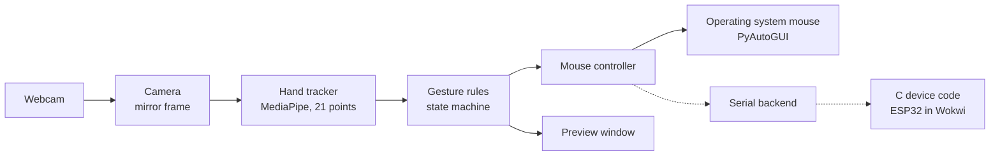

<div align="center">

# AI Gesture Control

**Control your mouse with one hand in front of your laptop's webcam. Everything runs on your own computer.**

[](https://github.com/khoahonguyen0210/AI_Gesture_Control/actions/workflows/ci.yml)


[](LICENSE)

</div>

AI Gesture Control watches your hand through the webcam and turns what you do into mouse moves, clicks, drags, and scrolls. It can also send the same actions to a small device over a serial connection. The device code is written in C and runs on a simulated ESP32 board.

## Overview

A mouse or trackpad is not always the easiest way to use a computer. This project asks a simple question: can one hand in front of an ordinary laptop webcam do the same job, safely and smoothly, with no extra hardware?

It also has a second part for anyone interested in small devices. The app can send each mouse action to a device as a short message. The device code is written in C, a second program written in C++ checks it, and it runs on a simulated microcontroller.

## Key features

- **Hand tracking**: finds 21 points on your hand in every webcam frame. Nothing goes to the cloud.
- **Simple gesture rules**: pointing, clicking, dragging, right clicking, and scrolling are found by measuring distances between your fingers. No trained gesture model is needed.
- **Safe mouse control**: a click happens once, a button never gets stuck, and there are several ways to stop the app.
- **Dry run**: shows what the app sees on screen without touching your mouse.
- **Device protocol in C**: sends mouse actions to a device as small messages, with a check for damaged data. The device lets go of every button if the computer goes quiet.
- **Fuzz testing**: a second parser written in C++ reads the same messages as the C parser, and the two must always agree. "Fuzzing" means feeding a program huge amounts of damaged or random input to find crashes.
- **Wokwi demo**: the device code runs on a simulated ESP32 board with a small screen and three LEDs.

| Gesture | On your computer | In the Wokwi simulator (`--serial`) |
|---|---|---|
| Point with your index finger | Move the cursor | The dot moves on the OLED screen |
| Quickly pinch your thumb and index finger | Left click | The green LED flashes |
| Pinch and hold, then move | Drag | The green LED stays on and the filled dot moves |
| Pinch your thumb and middle finger | Right click | The blue LED flashes |
| Raise your index and middle fingers, then move your hand | Scroll | The `S` number goes up or down |
| Press `p` | Pause or resume | The screen shows `PAUSED` and any held button is released |
| Press `q` or Esc | Quit | All buttons are released. After 5 seconds the board plays its demo |

## Architecture



- **Camera** reads a frame and flips it like a mirror, so moving your hand right moves the cursor right.
- **Hand tracker** uses MediaPipe's ready-made hand model to find 21 points on your hand.
- **Gesture rules** decide which gesture you are making from those points. A finger counts as straight when its tip is farther from the wrist than its middle joint. A pinch is the gap between two fingertips divided by the size of your hand, so it works the same near or far from the camera.
- **Mouse controller** smooths the cursor and sends each action to the system mouse. With `--serial`, it sends the action to the device instead.

## Tech stack

| Component | Technology | Purpose |
|---|---|---|
| App | Python 3.12 | Main program |
| Camera | OpenCV | Read webcam frames and draw the preview |
| Hand tracking | MediaPipe Hand Landmarker (pretrained), NumPy | Find 21 points on the hand |
| Mouse control | PyAutoGUI | Move, click, drag, and scroll the system mouse |
| Device code | C11, CRC-16 | Read messages from the computer on the device |
| Reference parser | C++17, libFuzzer | Check the C parser with fuzz testing |
| C checks | MSVC, Clang, GCC, AddressSanitizer, UBSan | Build the C code and catch memory mistakes and other hidden bugs |
| Simulated hardware | ESP32 (Arduino), SSD1306 OLED, PlatformIO, Wokwi, pyserial | Run the device code on a simulated board and connect the app to it |
| Testing and quality | pytest, Ruff, mypy | Run tests, check code style, and check types |
| CI and release | GitHub Actions, setuptools, build | Run the checks on every push and build release packages |

## Data model

**Hand points.** For every frame, the tracker returns 21 points on the hand. Each point has an x and y position between 0 and 1 (relative to the frame) and a depth value. The gesture rules use only these points, never the picture itself.

**Serial messages.** With `--serial`, each mouse action is sent as one small binary message. This example moves the cursor 12 pixels right and 5 pixels up:

```text
A5 01 10 07 04 0C 00 FB FF 28 9E
```

| Bytes | Field | Meaning |
|---|---|---|
| `A5` | Start | Marks the start of every message |
| `01` | Version | Protocol version 1 |
| `10` | Type | `MOVE`. Other types are `BUTTON`, `SCROLL`, `HEARTBEAT`, and `RELEASE_ALL` |
| `07` | Sequence | The message number, so each reply can be matched to its message |
| `04` | Length | Size of the data part, from 0 to 16 bytes |
| `0C 00 FB FF` | Data | Move by x = 12 and y = -5. Each is a 16-bit number, low byte first |
| `28 9E` | CRC | A check number calculated from the bytes between the start and the CRC, low byte first. The device uses it to spot damaged messages |

The device replies `ACK` (received) to every good message, and `NACK` (rejected) with a reason to every bad one.

## Gestures and safety

- **A click happens once.** A pinch must last 3 frames to count, and your fingers must open a little wider before it ends. A shaky pinch cannot click twice.
- **The click lands where you pointed.** The cursor stops moving when a pinch starts, so closing your fingers does not push it away.
- **A short pinch clicks, a long pinch drags.** Holding a pinch for 350 ms turns it into a drag.
- **No hand, no action.** If your hand leaves the camera view during a drag, the button is released after 5 frames. A second check in the main loop also releases any held button.
- **You can always stop it.** Press `p` to pause and `q` or Esc to quit. Moving the real cursor into a screen corner stops the app, and so does Ctrl+C in the terminal.
- **Every exit cleans up.** The buttons, camera, model, and window are released in a fixed order, even after an error.

All numbers here are starting values. You can change them in [`config/default.toml`](config/default.toml).

## Device code in C and C++

The device code is plain C, written so it could run on a small microcontroller. It checks every message with a CRC, recovers after random bytes, rejects anything it does not understand, and releases all buttons if the laptop stops sending.

To check this code, a second parser was written separately in modern C++ from the protocol rules. Both parsers read the same streams of bytes, and any difference counts as a bug. The C++ side calculates the CRC a different way, so the CRC is tested too. CI runs 200,000 damaged streams, and libFuzzer (a tool that invents tricky inputs) searches for new ones on its own. As a proof that the test works, a bug was planted in the C parser on purpose, and the test found 26,448 streams where the two parsers disagreed.

```bash
python firmware/build.py --test --sanitize
python firmware/build.py --fuzz 120
```

The [`firmware/wokwi/`](firmware/wokwi/) folder runs the same C files on a simulated ESP32 with a small OLED screen and three LEDs. The board shows each action, as listed in the right column of the gesture table. When no app is connected, it plays a demo that also sends bad messages, so you can watch the device reject them. No real board was used. Setup steps, the screen layout, and manual checks are in [`firmware/wokwi/README.md`](firmware/wokwi/README.md).

## Project roadmap

- [x] **Phase 1, Project setup**: the code skeleton and a settings file.
- [x] **Phase 2, Gestures and mouse**: the gesture rules and the mouse controller.
- [x] **Phase 3, Camera and hand tracking**: webcam capture and MediaPipe's 21 hand points.
- [x] **Phase 4, App loop**: the preview window, the pause and quit keys, and a clean shutdown after errors.
- [x] **Phase 5, Scripts and CI**: benchmark, recording, and evaluation scripts, automatic checks on Linux and Windows, and release packages.
- [x] **Phase 6, Speed**: found the slow parts and changed the camera driver, from 9.8 to 16.4 to 19.5 frames per second.
- [x] **Phase 7, Device protocol**: C device code with a CRC, a silence timeout, and tests that catch memory bugs.
- [x] **Phase 8, Fuzz testing**: a C++ parser checks the C parser.
- [x] **Phase 9, Wokwi demo**: the device code runs on a simulated ESP32.
- [ ] **Phase 10, Accuracy**: record labeled sessions with a real hand, tune the pinch limits, and measure how often each gesture is right.
- [ ] **Phase 11, Trained model**: compare a small trained model with the gesture rules on the same recordings.
- [ ] **Phase 12, Real board**: run the device code on a real ESP32 that works as a USB mouse.

Checked phases are done. Unchecked phases are not started.

## Performance benchmarking

Measured on one laptop (ThinkPad X1 Yoga, Intel i7-1260P, Windows 11, plugged in) at 640x480, in evening room light, with no hand in view. Each run is 2000 frames. The times cover everything the software does, from reading a frame to sending the mouse event. They do not include camera exposure or screen delay.

| Measure | Before profiling | After profiling |
|---|---|---|
| Frames per second | 9.8 | **16.4 to 19.5** |
| Median time per frame | 100.3 ms | **56.2 to 58.2 ms** |
| Camera start time, Media Foundation driver | 7.0 to 14.8 s | **3.0 to 4.0 s** |

| Other measures | Result |
|---|---|
| Automated tests | **177 passed**, no camera or mouse needed |
| Line coverage | **92%** overall, and **99 to 100%** for the gesture logic |
| C protocol tests | **1,000,068 checks** passed, with tools that catch memory bugs and undefined behavior |
| C and C++ parsers compared | **202,004** test streams and **533,065** fuzzed inputs, **0** differences |
| Failed camera reads in the benchmark runs | **0** of 6000 frames |
| ESP32 firmware for Wokwi | Builds with **0** warnings and uses **6.8%** of RAM and **23.1%** of flash |
| Gesture app connected to the Wokwi board | Every gesture shows on the board (checked by hand) |

Profiling showed that one Windows camera driver (DirectShow) gave only 9.9 frames per second, while another (Media Foundation) gave 30. Switching drivers helped the most. Most of each frame is now spent in the hand model, so rewriting code in C++ or Rust would not help, and it was not done.

These results come from one laptop and do not claim to hold on every computer. Every measurement and its conditions are in [`research/handover/test_log.md`](research/handover/test_log.md).

### Planned experiments

| Experiment | Purpose |
|---|---|
| Benchmark with a hand in view | Measure the time per frame while the model tracks a moving hand |
| Gesture accuracy on labeled recordings | Measure how often each gesture is recognized correctly |
| Different light and distance | See how tracking changes with the room and your distance from the camera |
| Other laptops | Check whether the results hold on other hardware |

The scripts for these are ready (see [Testing](#testing)).

## Getting started

### Prerequisites

- Windows 10 or 11
- A webcam (a built-in one is fine)
- Python 3.12 and Git
- Optional: a C compiler for the C tests, and VS Code with Wokwi and PlatformIO for the simulator

### 1. Clone the repository

```powershell
git clone https://github.com/khoahonguyen0210/AI_Gesture_Control.git
cd AI_Gesture_Control
```

### 2. Install and download the model

```powershell
py -3.12 -m venv .venv
.\.venv\Scripts\Activate.ps1
python -m pip install -e ".[dev]"
python scripts/fetch_model.py
```

The model file is downloaded once. It is not stored in the repository.

### 3. Try it without moving the mouse

```powershell
python -m gesture_mouse --dry-run
```

Check that the preview shows 21 points on your hand, and that the gesture name changes when you point, pinch, and raise two fingers.

### 4. Run it

```powershell
python -m gesture_mouse
```

| Option | Purpose |
|---|---|
| `--dry-run` | Show gestures but never move the mouse |
| `--camera 1` | Use another camera (`python scripts/list_cameras.py` lists them) |
| `--config my.toml` | Use your own settings file |
| `--log-level DEBUG` | Show more detail |
| `--max-frames 300` | Stop after 300 frames |
| `--serial PORT` | Send actions to a serial device instead of the mouse (see [`firmware/wokwi/README.md`](firmware/wokwi/README.md)) |

## Testing

One command runs every automated check in the same order as CI and prints a summary:

```powershell
python scripts/check_all.py          # the checks CI runs
python scripts/check_all.py --all    # also the real camera and the Wokwi firmware build
```

| Step | Command it runs | Needs |
|---|---|---|
| Package, code style, and types | `pip check`, `ruff check .`, `ruff format --check .`, `mypy src` | Nothing |
| C and C++ tests | `python firmware/build.py --test --sanitize` | A C compiler (MSVC, Clang, or GCC) |
| Python tests | `pytest -q -m "not hardware"` | Nothing |
| Camera tests (`--hardware`) | `pytest -q -m hardware` | The webcam and the model file |
| Firmware build (`--firmware`) | `pio run -d firmware/wokwi` | PlatformIO |

The Python tests use a fake camera, fake hands, a fake mouse, and a fake serial device, so they run anywhere. For every push, CI runs the same checks on Linux and Windows and builds the ESP32 firmware on Linux.

To measure speed and accuracy on your own machine:

```powershell
python scripts/benchmark.py --note "hand moving, desk lamp on"
python scripts/record_landmarks.py --note "daylight, 50 cm, right hand"
python scripts/evaluate_gestures.py --input "output/recordings/*.jsonl"
```

## Configuration

Settings live in [`config/default.toml`](config/default.toml). Copy the file, change only what you need, and pass it with `--config`. If any value is wrong, all the problems are listed at once, before the camera opens.

| Setting | Purpose |
|---|---|
| `camera.index`, `camera.backend` | Which camera and driver to use |
| `gesture.pinch_on`, `gesture.pinch_off` | How close the fingers must be to start a pinch, and how far apart to end it |
| `gesture.drag_hold_ms` | How long a pinch must last to become a drag |
| `cursor.smoothing_alpha` | A smaller value gives a steadier but slower cursor |
| `cursor.margin` | The part of the camera frame that is left out, so you can reach the screen edges |

## Repository layout

```text
src/gesture_mouse/   Camera, hand tracker, gesture rules, mouse control, preview, app
tests/               Automated tests with fake hardware
scripts/             Model download, camera list, benchmark, recording, evaluation, checks
firmware/            C protocol code, C++ reference parser and fuzzer, tests, Wokwi ESP32 demo
config/              Default settings
research/            Notes on other projects, dependency licenses, exact versions, test log, handover report
.github/             CI and release workflows
```

## Privacy and security

- Camera frames are processed in memory. They are never saved, sent, or uploaded.
- The only network use is the one-time model download and installing packages.
- Recordings for evaluation hold only the coordinates of the hand points, never images. They stay in the `output/` folder, which git ignores.
- Gestures can only move, click, drag, and scroll. They cannot type, run commands, open files, or start programs.
- The app uses no accounts, keys, or cloud services. The optional Wokwi demo needs a free Wokwi account, and the app sends it only mouse action messages over localhost.

## Limits

- Tested on one Windows laptop with one monitor. Other systems and setups with several monitors are untested.
- The keys work only while the preview window is in focus. The screen corner and Ctrl+C work at any time.
- Gestures need one hand and fine finger control, so they do not suit everyone. Keep the keyboard and trackpad as a fallback.
- Tracking quality can change with light, distance, and skin tone. No general accuracy is claimed.

## Engineering goals

- **Smooth in real time**: read, track, and act on every frame fast enough to feel instant.
- **Safe by default**: never click by accident and never leave a button held down.
- **Honest numbers**: every number comes from a logged run with its conditions written down.
- **Safe with bad input**: the device must handle damaged or random bytes without crashing.
- **Testable without hardware**: fake cameras, hands, mice, and serial devices let every test run in CI.
- **Ready for a small chip**: the C code uses fixed-size buffers and makes no hardware calls, so it could run on a microcontroller.

## Future improvements

- Support more than one monitor.
- Test on macOS and Linux.
- Add pause and quit keys that work without focusing the preview window.
- Add a short calibration step for each user's hand.
- Add a Docker environment so training and evaluation can be repeated on any machine.

## Author

This is a personal project, built from start to finish by one person. Issues and suggestions are welcome.

| Name | Role | Github |
|---|---|---|
| Khoa Ho Nguyen | Author and maintainer | [@khoahonguyen0210](https://github.com/khoahonguyen0210) |

## License

MIT. See [`LICENSE`](LICENSE). No code from other projects is copied into this repository. The licenses of all dependencies are listed in [`research/repo-audit/license_and_dependency_audit.md`](research/repo-audit/license_and_dependency_audit.md).
